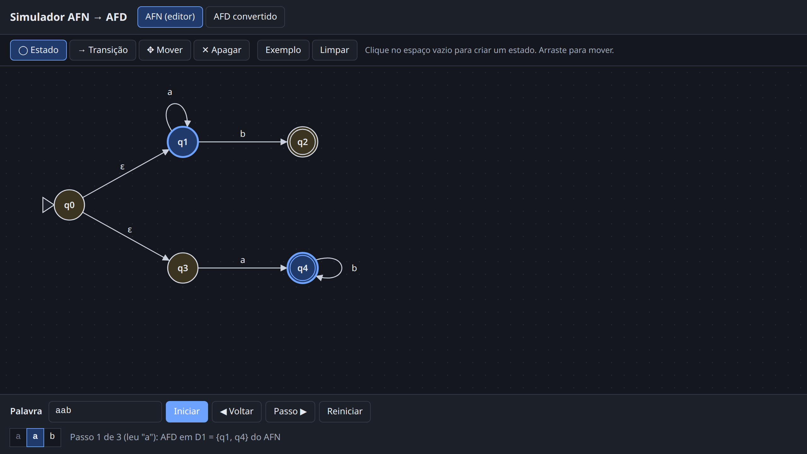
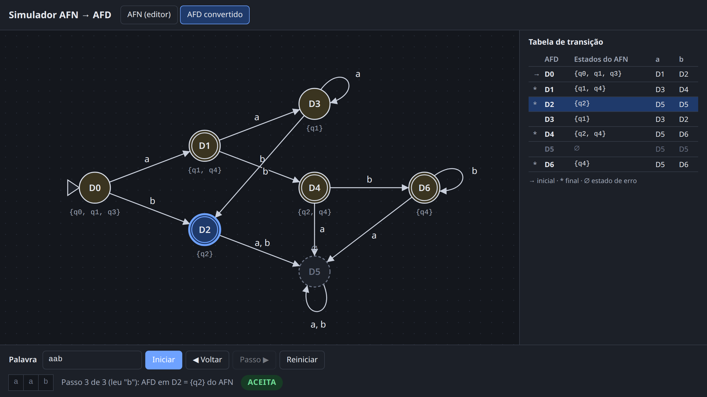

# Simulador AFN → AFD

Editor visual de autômatos finitos que converte um AFN (com transições ε) em AFD pela construção de
subconjuntos e executa palavras passo a passo. A lógica é em Python e a interface é web; o Python roda
no próprio navegador via Pyodide.


### ▶ [Abrir o simulador online](https://matheusquinteros.github.io/nfa-to-dfa-simulator/)

Não precisa instalar nada. Na primeira visita, o Python leva alguns segundos para carregar.

## Demonstração

Editor do AFN durante a execução da palavra `aab` (os estados ativos ficam em azul):



AFD gerado, com o conjunto de estados do AFN em cada estado, a tabela de transição e o resultado:



<!-- TODO: GIF curto (docs/img/demo.gif) montando um AFN com ε e executando uma palavra. -->

## O que o projeto faz

- **Editor gráfico de AFN:** cria estados com um clique, transições arrastando de um estado a outro
  (inclusive laços e transições ε) e marca estados inicial e finais pelo menu de contexto.
- **Conversão AFN → AFD:** gera o AFD equivalente e o desenha automaticamente, mostrando o conjunto de
  estados do AFN que cada estado representa, o estado de erro (∅) e a tabela de transição.
- **Execução passo a passo:** avança e volta símbolo a símbolo, destacando ao mesmo tempo o estado atual
  do AFD e os estados ativos do AFN, até o resultado (aceita ou rejeitada).
- **Validação do AFN:** estado inicial ausente, transição para estado inexistente ou símbolo fora do
  alfabeto geram uma mensagem de erro em vez de travar a interface.

## Destaques técnicos

- **Algoritmos implementados do zero.** Fecho-ε, a função *mover*, a construção de subconjuntos e a
  execução do AFD estão em Python usando só a biblioteca padrão. Cada estado do AFD é um `frozenset` de
  estados do AFN, o que permite usá-lo como chave de dicionário e detectar estados já vistos.
- **Lógica separada da interface.** O pacote `backend/` não depende da interface e pode ser importado e
  usado direto em Python. A conversão entre o formato da interface e o do backend fica concentrada em
  um único arquivo, [`gui/py/ponte.py`](gui/py/ponte.py).
- **O mesmo código Python no terminal e no navegador.** A interface baixa os arquivos de `backend/` e os
  executa com o [Pyodide](https://pyodide.org/) (CPython compilado para WebAssembly). Com isso o site é
  estático e é publicado no GitHub Pages sem servidor de aplicação.
- **Interface sem frameworks nem etapa de build.** HTML, CSS e JavaScript (módulos ES) com renderização
  em SVG. Uma mesma função de desenho atende o editor do AFN e a visualização do AFD; o AFD é organizado
  em colunas por busca em largura a partir do estado inicial.
- **Resultado determinístico.** Os símbolos são percorridos em ordem e os estados do AFD são numerados
  (`D0`, `D1`, …) por ordem de descoberta, então o mesmo AFN sempre gera o mesmo AFD.

## Como executar

**Online (mais fácil):** abra <https://matheusquinteros.github.io/nfa-to-dfa-simulator/>.

**Localmente:** é preciso Python 3 (testado com 3.12) e conexão com a internet, porque o Pyodide é
carregado de um CDN. Não há dependências para instalar nem etapa de compilação.

```bash
git clone https://github.com/MatheusQuinteros/nfa-to-dfa-simulator.git
cd nfa-to-dfa-simulator
python3 -m http.server 8080
```

Depois abra `http://localhost:8080/gui/`. A página precisa ser servida por HTTP (abrir o `index.html`
direto não funciona), porque baixa os arquivos `.py` do backend.

**Só o backend, no terminal:**

```bash
python3 -m backend
```

Ou como biblioteca:

```python
from backend import EPSILON, afn_para_afd, executar_afd

# L = a* ∪ b*
afn = {
    "estados": {"q0", "q1", "q2"},
    "alfabeto": {"a", "b"},
    "inicial": "q0",
    "finais": {"q1", "q2"},
    "transicoes": {
        "q0": {EPSILON: {"q1", "q2"}},
        "q1": {"a": {"q1"}},
        "q2": {"b": {"q2"}},
    },
}

afd = afn_para_afd(afn)
aceita, caminho = executar_afd(afd, "aaa")  # aceita == True
```

## Como usar

| Ação | Como fazer |
| --- | --- |
| Criar estado | Modo **Estado** (`E`) e clique no espaço vazio |
| Criar transição | Modo **Transição** (`T`) e arraste de um estado até outro (ou até ele mesmo, para um laço) |
| Transição ε | Deixe o campo de símbolos vazio (vários símbolos: `a, b`) |
| Inicial / final | Botão direito no estado |
| Ver o AFD | Aba **AFD convertido** |
| Testar uma palavra | Campo **Palavra** → **Iniciar** → **Passo ▶** (vazio = palavra ε) |

O botão **Exemplo** carrega um AFN pronto para a linguagem `a*b ∪ ab*`.

## Estrutura

```
backend/              # lógica dos autômatos (Python, só biblioteca padrão)
  automato.py         # formatos de AFN e AFD (TypedDict) e o símbolo EPSILON
  validacao.py        # verificação do AFN
  operacoes.py        # fecho-ε e mover
  conversao.py        # AFN -> AFD (construção de subconjuntos) e nomes D0, D1, ...
  simulador.py        # execução de palavras no AFD
  __main__.py         # demonstração no terminal (python3 -m backend)
gui/                  # interface web
  index.html
  css/estilo.css      # tema claro/escuro
  js/app.js           # liga editor, visualização do AFD e execução
  js/editor.js        # editor do AFN (mouse e teclado)
  js/desenho.js       # renderização SVG de estados e transições
  js/layout.js        # posicionamento automático do AFD
  js/afd.js           # visualização do AFD e tabela de transição
  js/execucao.js      # execução passo a passo
  js/pyodide.js       # carrega o Pyodide e copia o backend para dentro dele
  js/ui.js            # mensagens, caixa de texto e menu de contexto
  py/ponte.py         # adapta os dados da interface para o backend
index.html            # redireciona para gui/ (página publicada no GitHub Pages)
.nojekyll             # desliga o Jekyll no Pages (senão __init__.py não é publicado)
```

## Limitações conhecidas

- Não há testes automatizados nem CI no repositório.
- Cada símbolo do alfabeto é um único caractere.
- O AFD gerado não é minimizado.
- O autômato não é salvo: recarregar a página apaga o que foi desenhado.

## Contexto

<!-- TODO: nome e código da disciplina da UFRGS, e semestre. -->
Projeto feito a partir de um trabalho da disciplina de <!-- TODO --> da UFRGS.

Créditos: a definição das estruturas de AFN e AFD, suas funções e implementações foram escritas por mim. A interface web foram desenvolvidos com auxílio de IA (Claude, da Anthropic),
a partir das minhas especificações. O projeto usa o
[Pyodide](https://pyodide.org/), carregado do CDN jsDelivr; nenhum código de terceiros está copiado no
repositório.

## Licença

<!-- TODO: escolher uma licença (ex.: MIT) e adicionar o arquivo LICENSE. -->
Ainda sem licença definida.
